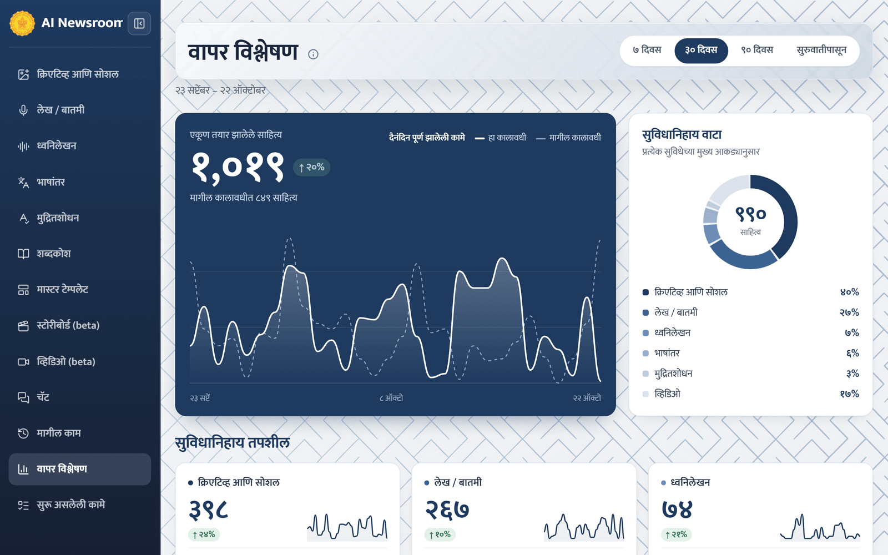
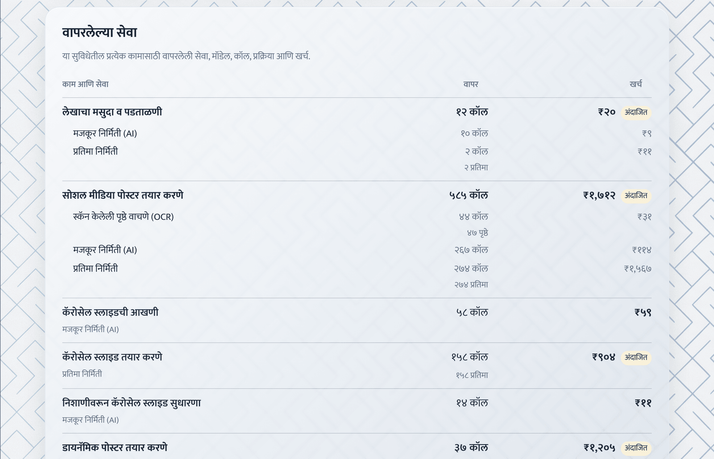

# Usage Analytics

Open **"वापर विश्लेषण"** for a combined view of how much the department uses the platform. All figures are department-wide; nothing on this page counts or identifies individual officers.

## Choose a period

Use **"७ दिवस"**, **"३० दिवस"**, **"९० दिवस"** or **"सुरुवातीपासून"**. The overview shows key figures, daily activity against the previous period, a year-long activity calendar, the share of work by feature, and one card per feature.

Select a feature card to open its detail page. The number on a card always matches its detail page.

## Read the service table

**"वापरलेल्या सेवा"** groups paid work under the task that caused it — transcription, document reading, article writing, translation, proofreading, poster and caption work, thumbnails, carousels, Dynamic Posters, storyboards and video phases. Each row shows the service, the number of calls, the unit processed (minutes of audio, pages, images, seconds of video) and the estimated cost in rupees.

A feature whose spend is not measured shows **"या सुविधेचा खर्च स्वतंत्रपणे मोजला जात नाही."** rather than ₹0. Values marked **"अंदाजित"** are estimates.

## Historical limits

Exact task-level history begins from August 2026. Older usage that cannot be broken down truthfully is shown as **"पूर्वीची एकत्रित AI नोंद"**.


Analytics is operational monitoring, not a supplier invoice. Usage logging never blocks an officer's work, so an occasional missing record is possible; use supplier invoices for financial reconciliation.

