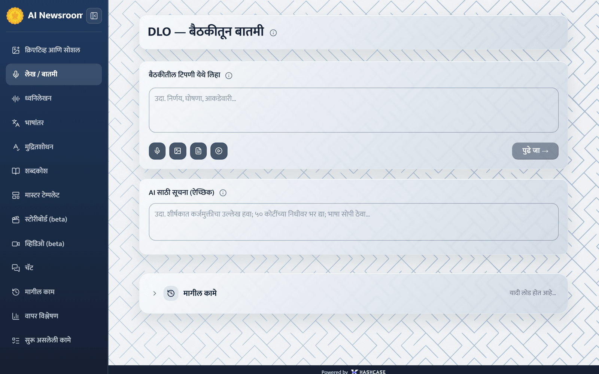

# Create a News Report

Use **"लेख / बातमी"** (page title **"DLO — बैठकीतून बातमी"**) to turn meeting material into a publication-ready Marathi **बातमी**. You give the sources and, optionally, one instruction; the article is then written straight away — there is no separate review step.

## 1. Add your sources

Everything goes into one box. Any one source is enough, and you may combine them. The four round buttons under the box add files and links (hover over a button to see its name):

- **"बैठकीतील टिपणी येथे लिहा"** — type or paste notes.
- **"ध्वनिफीत जोडा"** (microphone) — recordings in MP3, M4A, AAC, WAV, FLAC, OGG, OPUS or WEBM. You can also pick a phone **video** (MP4, MOV, MKV, 3GP): only its sound is taken out, in your browser, and the video itself is never uploaded. A converting video shows **"व्हिडिओमधून"** on its card.
- **"प्रतिमा जोडा"** (picture) — photographs of a GR, notice, letter or table (JPG, PNG, WEBP).
- **"कागदपत्र जोडा"** (page) — PDF, DOCX or TXT files. Documents are read whole; you do not choose pages.
- **"यूट्युब व्हिडिओ"** (play) — paste a YouTube link. The card shows the video's title so you can confirm it is the right one.

### Use only part of a recording

Select a recording's card to open **"ध्वनिमुद्रणाचा कोणता भाग वापरायचा?"**. Drag the two edges of the waveform (or slide the middle) to the part you need, then select **"हाच भाग वापरा"**. Only that part is transcribed. **"पूर्ण ध्वनिमुद्रण वापरा"** goes back to the whole file. The original recording is kept, so you can widen the window later.

## 2. Say what you want (optional)

Use the second box, **"AI साठी सूचना (ऐच्छिक)"**, to direct the article in your own words, in one place — the headline or angle, what to stress, what to leave out, how simple the language should be, how long it should be, or an older news report whose style to follow. For example: “शीर्षकात कर्जमुक्तीचा उल्लेख हवा; ५० कोटींच्या निधीवर भर द्या; भाषा सोपी ठेवा”.

This instruction decides **how** the article is written. It is never a source of facts: a name or number that appears only in the instruction is not added to the article.

If you ask for a length (for example “बातमी १२०० अक्षरांची हवी”), the platform measures the result and adjusts it once. If your sources do not contain enough material to reach that length, the article is delivered shorter with the notice **"मागितलेली लांबी गाठता आली नाही"** — it is never padded.

## 3. Start

Select **"पुढे जा →"**. The platform reads the documents and photographs, transcribes recordings and links, then writes the article. You are taken to the result page, where the article appears as it is written.

Your work is saved automatically. At the bottom of the **लेख / बातमी** page, **"मागील कामे"** lists recent work from all officers; open any item to pick it up again, from another tab or another computer.

## 4. Check the article

Where the shared glossary holds a verified designation for a person, the platform can place it before the name (for example **मुख्यमंत्री देवेंद्र फडणवीस**). It also applies the department's [Editorial Rules](editorial-rules.md). If a designation could not be placed, the article shows **"पदनामाबाबत लक्ष द्या"**.


There is no approval screen before writing any more. Read the finished article against the originals — especially names, designations, dates, amounts and quotations. Photographs and scanned pages can be misread, and Devanagari digits are the most common error.


## Practise

The **प्रशिक्षण** lesson **"बैठकीतून बातमी तयार करा आणि बदल करा"** walks through this whole journey on sample material, at no cost.
