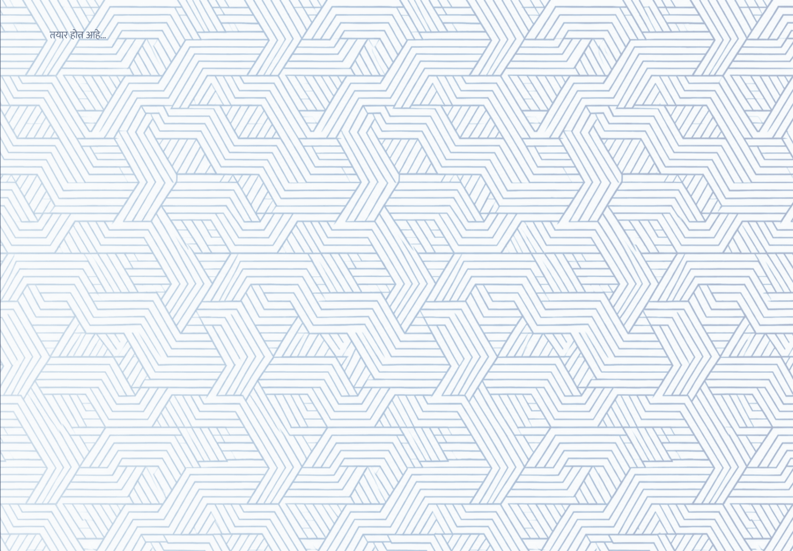
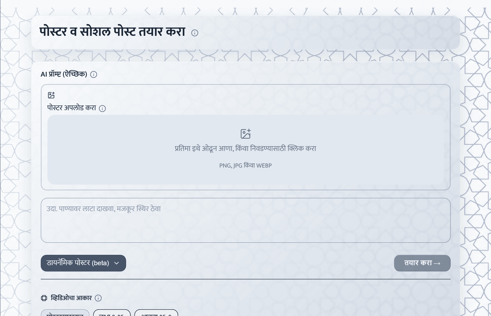
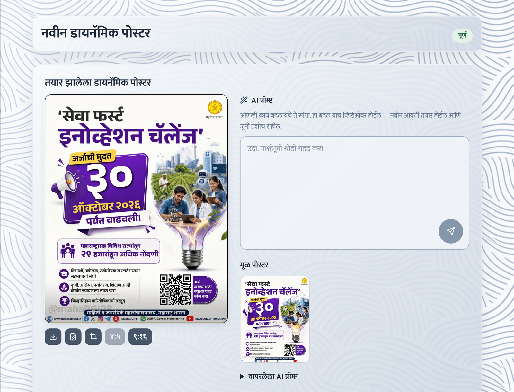

# Carousels and Dynamic Posters

Both formats are chosen from the format menu on **"क्रिएटिव्ह आणि सोशल"** (see [Create a Creative or Social Post](create-content.md)).

## Carousel (कॅरोसेल)

A carousel is one social post made of several slides: a cover (**"मुखपृष्ठ"**) followed by detail slides, all sharing one header, colour scheme and typography.

### Create one

1. Paste the text exactly as for a Creative poster.
2. Choose **"कॅरोसेल"** in the format menu.
3. Under **"स्लाइड"**, choose **"स्वयं"**, **३** or **४**. **"स्वयं"** makes three or four slides depending on how much text there is.
4. Optionally tick **"जसाच्या तसा मजकूर"**. Every line you wrote is then printed unchanged; the AI only decides which line goes on which slide and never drops one. Unticked, the AI writes the slide text from your material.
5. Optionally tick **"कॅप्शनही तयार करा"**, attach pictures, pick a template, then select **"तयार करा →"**.

Every number on a slide must appear in your text; a line whose figure cannot be found there is left out rather than printed wrongly.

### Review and change slides

The result page shows the slides side by side, each labelled with its number and title; on a phone, swipe through them.

- Each slide has its own download, and a download without the logo and footer.
- **"हा स्लाइड पुन्हा तयार करा"** redraws one slide in the same look.
- **"सर्व स्लाइड पुन्हा तयार करा"** redraws every slide with a new look (you are asked to confirm).
- **"ही स्लाइड संपादित करा"** opens the same red-mark and free-space tools as a single poster, for that slide only. See [Improve Results with Feedback](improve-with-feedback.md).
- Each slide keeps its own versions.

If a slide failed, the retry creates only the missing slides; finished slides are kept.


Direct publishing and Canva handoff are not yet available for carousels. Download the slides and copy the caption.


## Dynamic Poster (डायनॅमिक पोस्टर, beta)

A Dynamic Poster turns a finished poster you already have into a short looping clip, delivered as an MP4 and a GIF.

### Create one

1. Choose **"डायनॅमिक पोस्टर (beta)"** in the format menu. The text box is replaced by an upload area.

   

2. Under **"पोस्टर अपलोड करा"**, drop or select a PNG, JPG or WEBP image.
3. Optionally write **"AI प्रॉम्प्ट (ऐच्छिक)"** — what should move, for example “झेंडा फडकवा, फोटो स्थिर ठेवा”. Left empty, the platform decides.
4. Under **"व्हिडिओचा आकार"**, choose **"पोस्टरसारखाच"** (recommended), **"उभा ९:१६"** or **"आडवा १६:९"**. A different shape is filled with bars in the poster's own colours; no part of the poster is cut off.
5. **Mark the part that should move.** Draw a box (**"चौकट निवड"**) or a free-hand outline (**"मुक्त रेषा निवड (लॅसो)"**) on the poster. Only that part moves; everything else — text, numbers, logo, footer — stays exactly as you uploaded it.
6. Select **"तयार करा →"**.


If you do not mark a moving part, the whole poster is redrawn by the video model and its Marathi text can come out changed or garbled. Always mark the moving part when the poster carries text.


### Use and refine the result

The card **"तयार झालेला डायनॅमिक पोस्टर"** shows the clip, with **"मूळ पोस्टर"** (your upload) beside it.

- **"व्हिडिओ डाउनलोड"** and **"GIF डाउनलोड"**.
- **"लोगो व फूटर जोडा"** / **"लोगो व फूटर नको"** — add or remove the official branding on the clip.
- **"व्हिडिओचा भाग निवडा (क्रॉप)"** — drag a box over the finished clip and select **"क्रॉप करा"** to keep only that part. The **४:५** and **९:१६** buttons start a box already at that shape, for a feed post or a reel. Cropping costs nothing and can be repeated; the original is kept as an earlier version.
- **"AI प्रॉम्प्ट"** — describe a change (for example “पार्श्वभूमी थोडी गडद करा”) and select **"बदल करा"**. This makes a new paid version.
- **"आवृत्त्या"** — every version is kept; select one to view it.
