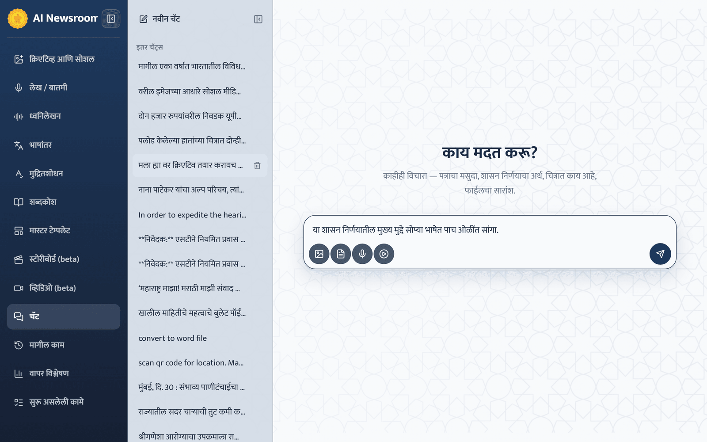

# Chat

**"चॅट"** is a general assistant for everyday work that is not one of the publishing journeys — drafting a covering letter, explaining a GR, summarising a forwarded PDF, reading a photograph, or answering a question.

## Ask something

1. Select **"नवीन चॅट"**.
2. Type in **"इथे लिहा…"** and select **"पाठवा"**. The answer appears as it is written; **"थांबवा"** stops it.
3. Continue the conversation with follow-up questions.

## Attach material

Use the round buttons under the box — up to ten attachments per message:

- **"दस्तऐवज"** — PDF, DOCX or TXT. Large PDFs (up to 512 MB) are searched rather than read word for word, so ask specific questions about long documents.
- **"ध्वनिमुद्रण"** — a recording (or phone video, whose sound only is used). It is transcribed first; it then also appears in **ध्वनिलेखन**.
- **"चित्र"** — a photograph or screenshot. You can also paste an image.
- **"यूट्युब लिंक"** — transcribed, then used in the conversation.

Wait until every attachment shows it is ready before relying on the answer.

## Your chats

The list on the left shows **"तुमच्या चॅट्स"** (started in this browser) and **"इतर चॅट्स"**. Select one to reopen it; **"चॅट काढून टाका"** deletes it permanently.


Chat is not a publishing tool. It does not use the glossary, the editorial rules or the platform's never-invent safeguards, so do not publish its answers directly — use **लेख / बातमी** or **मुद्रितशोधन** for that. Every chat can be opened by anyone with the application address; do not paste confidential material.

