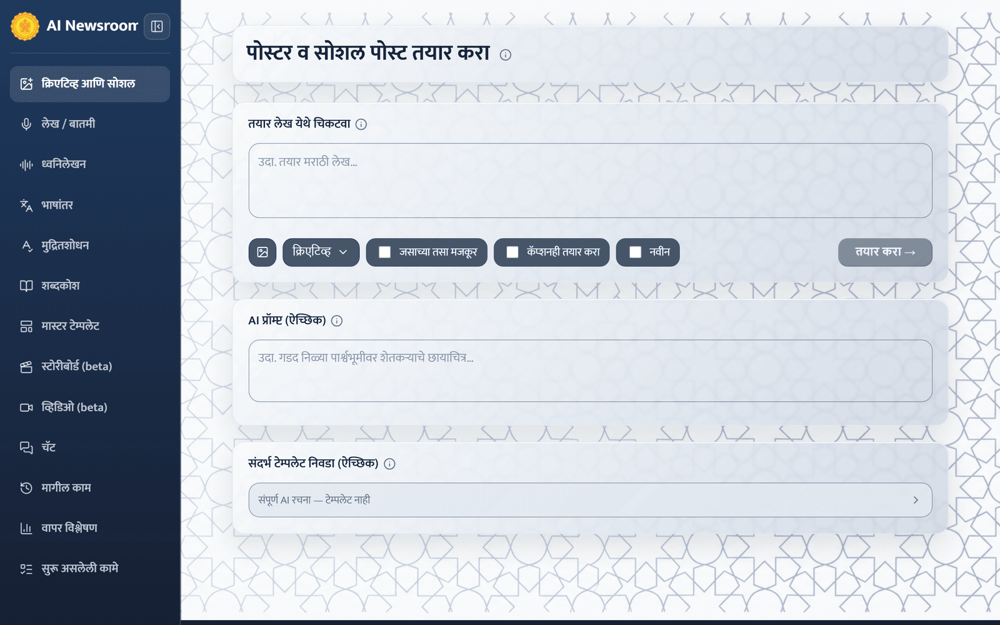
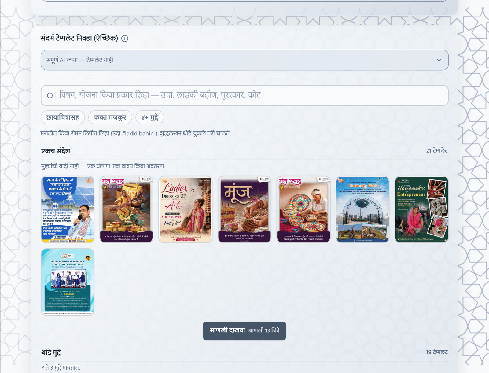

# Create a Creative or Social Post

Use **"क्रिएटिव्ह आणि सोशल"** (page title **"पोस्टर व सोशल पोस्ट तयार करा"**) when you already have the text and need its visual or social form. No article is written on this page — what you type or attach is the only source.

## 1. Add the text

Type or paste into **"पोस्टरवर जो मजकूर हवा आहे तो येथे लिहा"**. Select **[+]** to attach a PDF, DOCX or TXT file as well; you may use the text box, a file, or both. The file's text is counted beside what you typed, not pasted into the box.

- A DOCX or TXT is read immediately.
- A PDF shows **"पृष्ठे निवडायची आहेत"** on its card. Open the card and tick only the pages you need — only those pages are read (OCR is charged per page).

## 2. Choose what to create

Open the format menu in the composer's tool row and choose one:

| Format                       | What you get                                                                                       |
| ---------------------------- | -------------------------------------------------------------------------------------------------- |
| **क्रिएटिव्ह**               | A DGIPR-branded Marathi social-media poster (the default)                                          |
| **कॅरोसेल**                  | A 3–4 slide post — a cover and detail slides in one look. See [Carousels and Dynamic Posters](carousel-and-dynamic-poster.md) |
| **यूट्यूब थंबनेल**           | A Marathi YouTube thumbnail                                                                        |
| **फक्त कॅप्शन**              | A social-media caption only — no poster, no image cost                                             |
| **बॅनर**                     | A landscape poster to publish with an article; it prints only the main name or heading             |
| **डायनॅमिक पोस्टर (beta)**   | A short moving clip made from a poster you already have. See [Carousels and Dynamic Posters](carousel-and-dynamic-poster.md) |
| **व्हिडिओ**                  | Opens the separate storyboard-to-video workflow. See [Storyboard-to-Video Projects](video.md)      |

## 3. Choose the options

Only the options that affect the chosen format are shown.

- **"जसाच्या तसा मजकूर"** (Creative and Carousel) — tick it to print your text exactly, without changing a word. Leave it unticked to let the AI write the poster's headline and points from your text.
- **"कॅप्शनही तयार करा"** (Creative and Carousel) — also write a Marathi caption. You can add one later from the result page instead.
- **"नवीन"** — use the newer image model for this poster. Redos and changes on the same poster keep using it.
- **"प्रतिमा जोडा"** — attach up to four of your own pictures (JPG, PNG or WEBP) — a building, a person, a look you want. The image model uses the actual pictures. A picture that fails to upload stays on its card and is not sent.
- **"पोस्टरवरील मजकूर (ऐच्छिक)"** (Banner only) — the exact words to print. Leave it empty to let the platform pick the scheme, award or programme name from your text.

## 4. Optional: write the design yourself

On the Creative format, **"AI प्रॉम्प्ट (ऐच्छिक)"** lets you describe how the poster should look in your own words, for example “गडद निळ्या पार्श्वभूमीवर शेतकऱ्याचे छायाचित्र…”. When you fill it, the platform's own design instructions are skipped entirely and your description is used instead. The official logo and footer are still added afterwards.

## 5. Choose a template only when needed

Open **"संदर्भ टेम्पलेट निवडा (ऐच्छिक)"** to base the poster on a master template.

- On **क्रिएटिव्ह** and **कॅरोसेल**, leaving it empty means **"संपूर्ण AI रचना — टेम्पलेट नाही"**: colours, layout and arrangement are designed fresh. Pick a template only if you want the poster to follow it.
- On **यूट्यूब थंबनेल** and **बॅनर**, leaving it empty lets the platform pick a suitable template.

Templates are grouped by how many points they hold (one message, a few points, a medium list, a long list). Choose one that fits all your points. A template controls layout only — its words, numbers, people and logo are never copied.

## 6. Start

Select **"तयार करा →"**. The result page opens and the work appears under **"सुरू असलेली कामे"**. Only one social post and one article can be in progress at a time; the form tells you if you must wait.

Before starting, confirm:

- the text is final and approved;
- **"जसाच्या तसा मजकूर"** is ticked if every word must appear unchanged;
- a banner's exact text is correct, if you supplied one;
- a chosen template has room for all your points.


The महाराष्ट्र शासन badge and the DGIPR footer are added by software after the image is made. Do not ask the image model to paint them.

