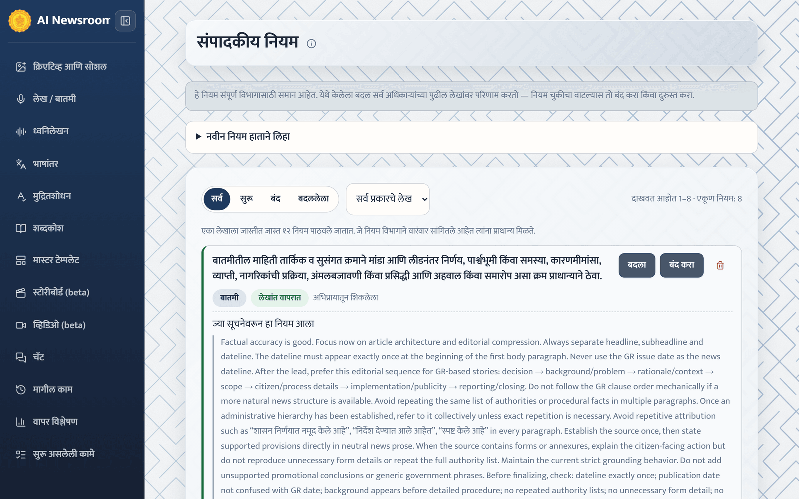

# Editorial Rules

**"संपादकीय नियम"** holds the department's standing rules for how news reports are written — for example “शीर्षक १० शब्दांच्या आत ठेवा” or “निर्णयाची तारीख पहिल्या परिच्छेदात द्या”. Every active rule is applied to every new news report and to every revision of one.

The page is not in the menu. Add `/preferences` to the end of the application address, or open it from **"संपादकीय नियम तपासा किंवा बदला →"** on an article that has just learned a rule.

## Where rules come from

- **"अभिप्रायातून शिकलेला"** — learned automatically from article feedback that describes a lasting preference. Feedback that corrects a fact about one article (a figure, a name, a date) is never turned into a rule.
- **"हाताने लिहिलेला"** — written by an officer with **"नवीन नियम हाताने लिहा"**.

When the same preference is given again, the existing rule is reinforced instead of duplicated. A newer rule can replace an older one, which is then shown as **"बदललेला"**.

## Add a rule

1. Select **"नवीन नियम हाताने लिहा"**.
2. Write the rule under **"नियम"**. Say only how to write — never put a name, date, amount, designation, scheme name or place in a rule; that information always comes from each article's sources.
3. Under **"कोणत्या लेखांना लागू"**, choose which articles it applies to.
4. Select **"नियम जोडा"**.

## Review rules

Each rule shows its status (**"सुरू"**, **"बंद"** or **"बदललेला"**), how often it has been reinforced and, for a learned rule, the feedback it came from with a link to that article.

- **"बंद करा"** stops a rule from being applied; **"पुन्हा सुरू करा"** restores it.
- Edit or delete a rule if it is wrong.

At most a fixed number of rules is sent with each article; rules the department has repeated most often take priority.


These rules are shared by the whole department. A change here affects every officer's next article — if a rule looks wrong, turn it off or correct it.


The officer's own instruction for one article (**"AI साठी सूचना"** or feedback) always outranks a standing rule.
