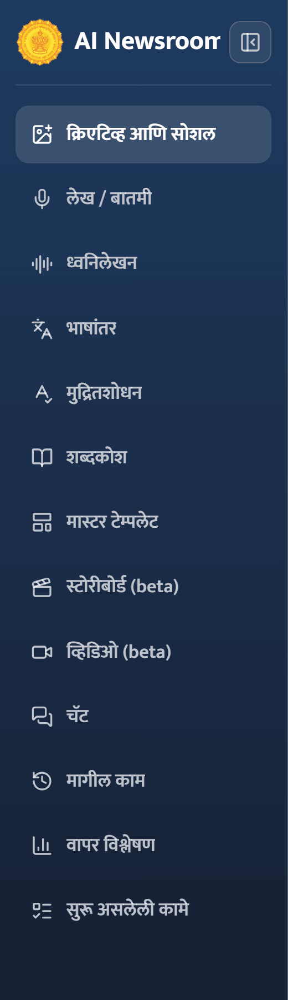
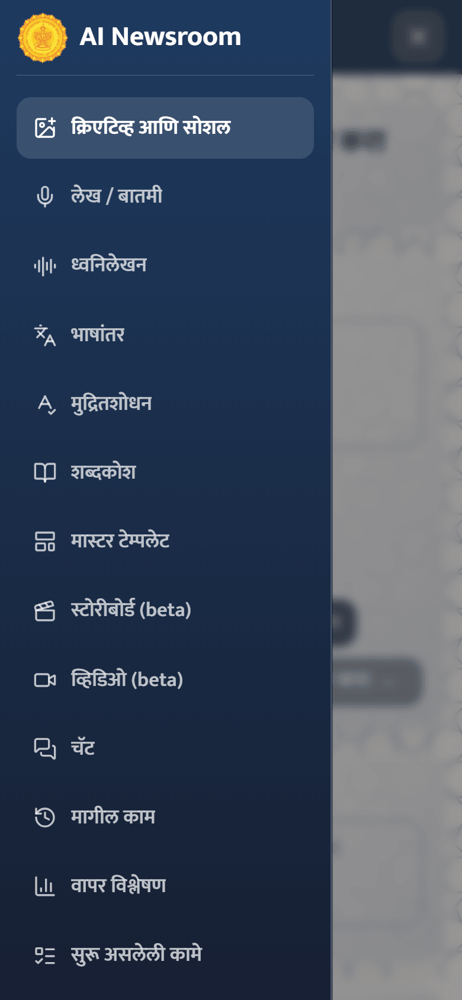

# Getting Around the Platform

The desktop application uses a permanent menu on the left. The highlighted row shows the page you are using.

## Menu pages

| Marathi label             | Use it for                                                                                   |
| ------------------------- | -------------------------------------------------------------------------------------------- |
| **क्रिएटिव्ह आणि सोशल**   | Posters, carousels, YouTube thumbnails, banners, captions and Dynamic Posters                |
| **लेख / बातमी**           | A Marathi news report from notes, recordings, photographs, documents and YouTube links       |
| **ध्वनिलेखन**             | Word-for-word transcription of recordings and YouTube links                                  |
| **भाषांतर**               | Translation between Marathi, English and Hindi                                               |
| **मुद्रितशोधन**           | Marathi or English proofreading                                                              |
| **शब्दकोश**               | Shared Marathi, English and Hindi spellings and designations                                 |
| **मास्टर टेम्पलेट**       | The poster template library (admin)                                                          |
| **स्टोरीबोर्ड (beta)**    | Write a video script and storyboard in a conversation, with pictures on request              |
| **व्हिडिओ (beta)**        | Create and edit a short video in a conversation                                              |
| **चॅट**                   | A general assistant for drafting, explaining and reading attachments                         |
| **मागील काम**             | Search and reopen saved posters, articles and social posts                                   |
| **वापर विश्लेषण**         | Department-wide outputs, service use and cost estimates                                      |

Use the small collapse button beside the logo when you need more horizontal space. The icons remain available while the menu is collapsed.

Two pages are not in the menu:

- **संपादकीय नियम** (`/preferences`) — the department's standing writing rules. It also opens from the link that appears on an article after a rule has been learned. See [Editorial Rules](editorial-rules.md).
- **प्रशिक्षण** (`/learn`) — practice lessons that cost nothing.

## Ongoing work

Long operations continue in the background. Select **"सुरू असलेली कामे"** at the bottom of the menu to see them.

- Select a task to open its progress or result page.
- You can leave a result page while work continues.
- A failed task shows an error and, when supported, a retry button.
- The panel is not the permanent archive; use **"मागील काम"** for saved work.

## On a phone

Select the menu button at the top-left to open the same navigation as a drawer. Select a destination and the drawer closes.

On Android, the site can be installed as an app. Once installed, you can share a recording straight from WhatsApp or the recorder app to **ध्वनिलेखन**, and the transcript starts automatically.


The interface opens without signing in. Anyone with the application address can reach the pages — including other officers' chats and work lists — so do not paste material your department has not authorised for this system.

