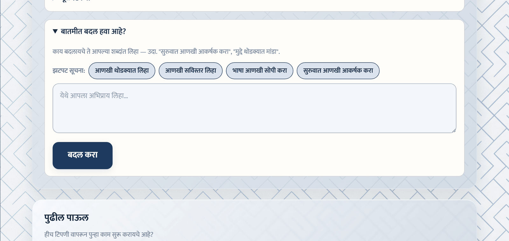
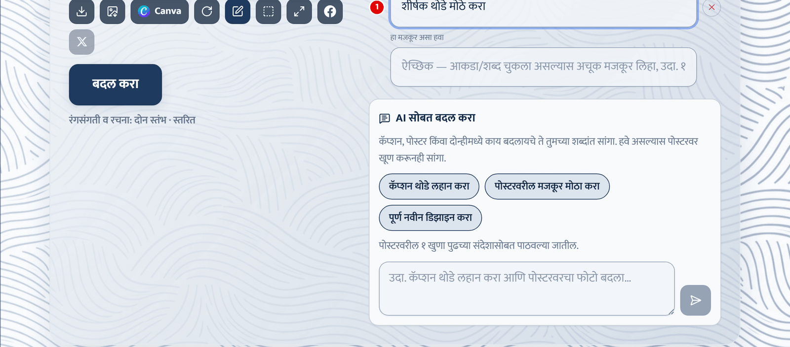
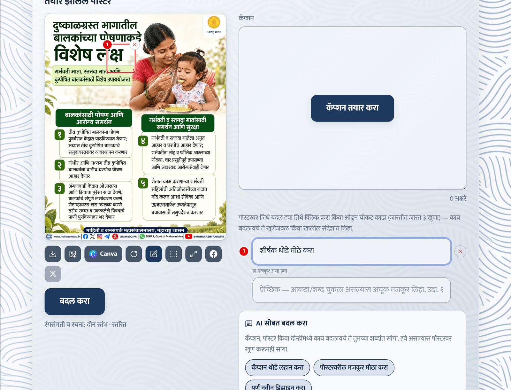

# Improve Results with Feedback

Use feedback when the facts are correct but wording, design, imagery or emphasis needs to change. If the facts themselves are wrong, correct the source and start a new run.

## Change an article

Open **"बातमीत बदल हवा आहे?"** under the article. Choose a quick suggestion — **"आणखी थोडक्यात लिहा"**, **"आणखी सविस्तर लिहा"**, **"भाषा आणखी सोपी करा"**, **"सुरुवात आणखी आकर्षक करा"** — or write your own instruction, then select **"बदल करा"**.

Good instructions describe the outcome without introducing a new fact, for example:

- “नागरिकांनी काय करावे हे स्वतंत्र परिच्छेदात मांडा.”
- “बातमी १२०० अक्षरांची करा; नावे आणि आकडे बदलू नका.”

Each revision becomes a new version under **"बातमीच्या आवृत्त्या"**; earlier versions are never lost.

When an instruction is a lasting preference rather than a one-off fix (for example “शीर्षक १० शब्दांच्या आत ठेवा”), the platform may remember it as a rule for future articles and show **"अभिप्रायातून शिकलेले नियम"**. A correction about one article's facts is never turned into a rule. See [Editorial Rules](editorial-rules.md).

## Ask for any poster change in your own words

Under a poster (and under a caption) is **"AI सोबत बदल करा"**. Write what you want in Marathi or English — a small fix (“शीर्षक मोठे करा”), a whole new design (“हे आवडले नाही, पूर्ण नवीन डिझाइन करा”), a caption change, or both together (“कॅप्शन थोडे लहान करा आणि पोस्टरवरचा फोटो बदला”) — and select **"पाठवा"**. The quick suggestions under the box are a starting point.

You do not choose an action: the assistant decides whether you mean the caption, the poster, a full redesign or both, and starts it. If it cannot tell, it asks one short question; answer it in the same box. It never adds a name, number or date you did not write.

The conversation is remembered in this browser, so a follow-up such as “आता आणखी थोडे लहान” builds on what you asked before. **"संभाषण पुसा"** clears it. Any marks on the poster travel with your next message.

## Point to a poster element (red marks)

Select the pencil icon, **"चित्रात बदल करा (पोस्टरवर खूण करा)"**, under the poster.

1. Click a point, or drag a box, over the element to change. You can add up to three numbered marks.
2. Beside each mark, write what should change — or describe it in the **"AI सोबत बदल करा"** box, for example “१ वरचा फोटो बदला आणि २ मधला मजकूर मोठा करा”.
3. Select **"बदल करा"** (or **"पाठवा"** in the chat box).

A red mark points to an element; it is not a crop or mask. The change applies to the whole element around the mark.

### Fix a wrong number or word exactly

If a figure or word on the poster is printed wrong (for example **९९** instead of **११**, or a broken conjunct), mark it and type the correct text in **"हा मजकूर असा हवा"** under that mark. That spot is then corrected on its own, using a typeset spelling of exactly what you typed, and the rest of the poster is left untouched. This is the most reliable way to fix a single misprinted digit or word.


The image model can confuse look-alike Devanagari digits such as **१** and **९**. Always check every number on a poster against your source.


## Leave space for your own logo or photograph (blue boxes)

Select the dotted-square icon, **"जागा मोकळी करा (स्वतःच्या लोगोसाठी)"**, and drag a blue box over the area. You can add up to two boxes. For each, choose:

- **"दुसरीकडे हलवा"** — move what is there elsewhere on the poster; the layout may change.
- **"काढून टाका"** — remove it; nothing else moves.

Either way the area is left as plain continuing background, so you can place your own item there later. This tool does not place the item for you.

Do not mark the software-added badge or footer: they are re-added after every change, so space there cannot be freed.

## Versions

Every successful poster render is kept as its own version. Use **"आधीच्या आवृत्त्या"** to compare, download or restore one — the restored version becomes current and later changes are made on it. No version is deleted.

Every poster change — a redesign, a marked change or an exact-text fix — incurs image-generation cost. Caption changes do not.
