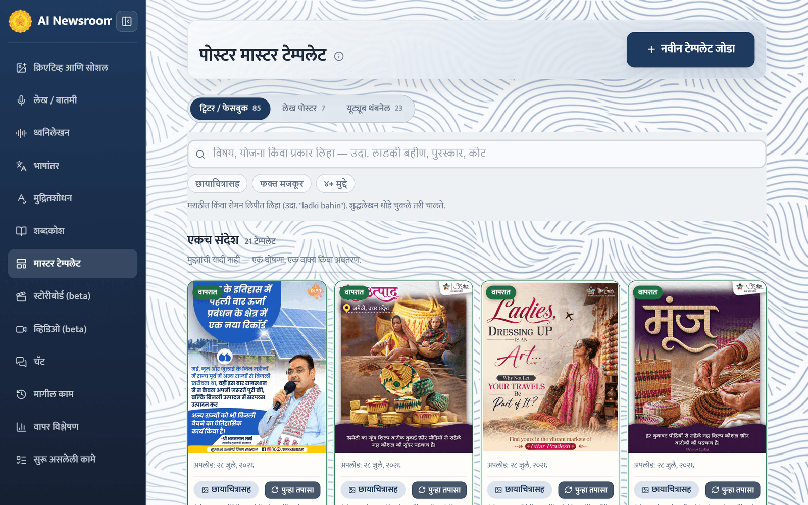
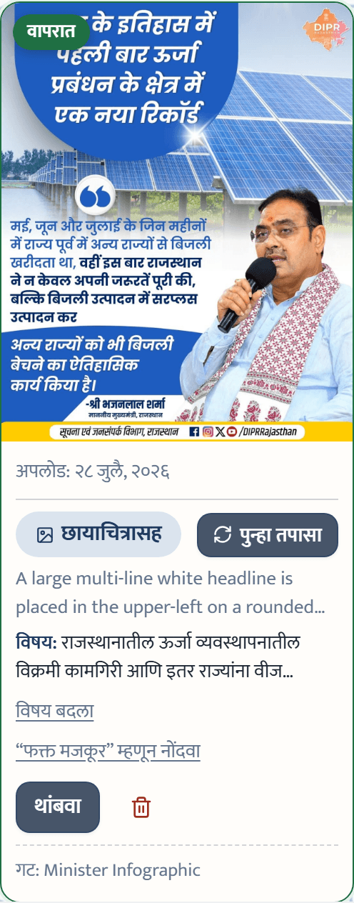

# Master Templates — Admin

**"मास्टर टेम्पलेट"** (page title **"पोस्टर मास्टर टेम्पलेट"**) is the visual reference library for Creative, Carousel, Banner and YouTube-thumbnail posters. It is an administrative workspace.

## Browse the library

Use the tabs **"ट्विटर / फेसबुक"**, **"लेख पोस्टर"** and **"यूट्यूब थंबनेल"**, and search by subject. Templates are grouped by how many points they hold:

- **"एकच संदेश"** — no list; one announcement, sentence or quote;
- **"थोडे मुद्दे"** — 1 to 3 points;
- **"मध्यम यादी"** — 4 to 6 points;
- **"मोठी यादी"** — 7 or more points;
- **"अजून तपासलेली नाहीत"** — not yet analysed.

Use **"आणखी दाखवा"** to see more in a group. When a poster is made without a chosen template (Thumbnail and Banner), one of the templates marked **"वापरात"** is picked automatically — one that has room for all the points.

## Add a template

1. Select **"नवीन टेम्पलेट जोडा"**.
2. Answer **"या टेम्पलेटमध्ये किती मुद्दे मावतात?"** by counting the point spaces in the image and choosing a group. This choice is kept permanently, even after re-analysis.
3. Select **"चित्र निवडा"** and choose a PNG, JPEG or WebP image. It is added immediately and analysed.

Analysis records whether the layout has a photograph area and summarises what it is about and how it arranges information. It never turns words or facts in the template into source material.

## Manage a template

- **"वापरा"** / **"थांबवा"** — enable or disable it for automatic selection.
- **"पुन्हा तपासा"** — re-run the analysis.
- **"“छायाचित्रासह” म्हणून नोंदवा"** / **"“फक्त मजकूर” म्हणून नोंदवा"** — correct whether the layout has a photo area.
- **"विषय बदला"** — edit **"हे टेम्पलेट कशाबद्दल आहे?"**.
- **"काढा"** — delete permanently.

Disabling is safer than deleting when a template may be needed later.


Upload a template only if the department may reuse its visual structure. Logos, text, dates, URLs, QR codes, people and claims in a template are placeholders and are never copied into a new poster.

