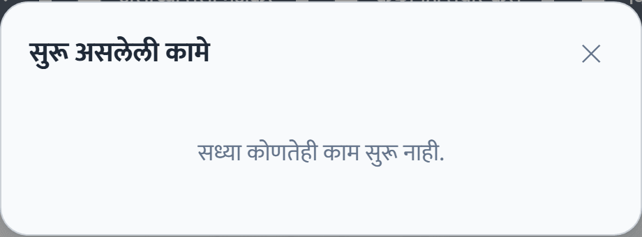
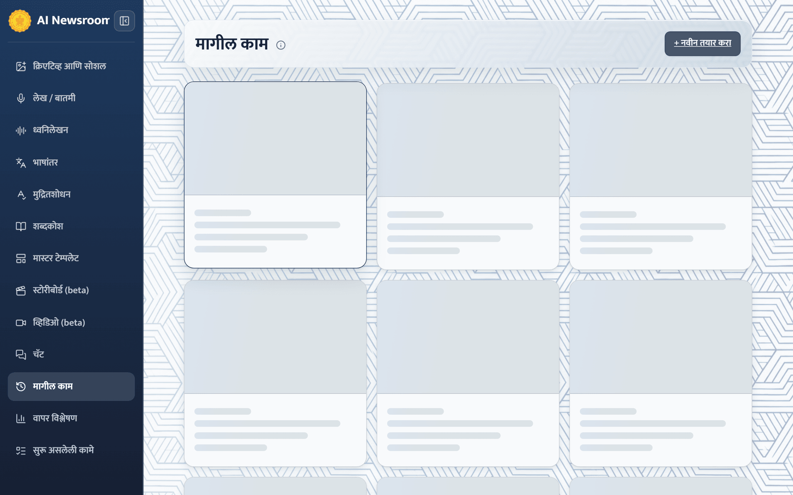

# Ongoing Tasks, Reuse and History

The platform separates temporary task monitoring from permanent saved work.

## Ongoing tasks

Select **"सुरू असलेली कामे"** to see background work. A task can be opened while it is running or after it completes.

Closing the panel or visiting another page does not cancel a task. A browser refresh reconnects to work running on the server; a file you had picked but not yet submitted may need to be picked again.

## Reuse approved material

A result page may offer, under **"पुढील पाऊल"**:

- **"याच मजकुरावरून ट्विटर पोस्ट तयार करा"** / **"याच मजकुरावरून फेसबुक पोस्ट तयार करा"**;
- **"याच लेखावरून क्रिएटिव्ह पोस्टर तयार करा"**;
- **"या बातमीसाठी पोस्टर तयार करा"**;
- **"टिपणी बदलून पुन्हा तयार करा"** — edit the source and run again.

These follow-ups are linked. **"याच टिपणीवरून तयार झालेली कामे"** shows every run made from the same source. Use them when the source is still valid; if the official source has changed, start a new run so the record does not suggest the old source supported a new fact.

## Browse saved work

Open **"मागील काम"** to see every saved news report, poster, carousel, thumbnail, banner, caption and Dynamic Poster.

- Search with **"मागील काम शोधा…"**.
- Filter by **"प्रकार"** (format), **"स्थिती"** (status) and **"कालावधी"** (**"आज"**, **"७ दिवसांत"**, **"३० दिवसांत"**).
- Sort with **"क्रम"** — **"नवीन आधी"** or **"जुने आधी"**.
- Tick **"कार्डवरील मजकूर दाखवा"** to show each card's text.
- Select a card to reopen it; use the page controls for older work (twelve per page).
- **"+ नवीन तयार करा"** opens the create form.

News-report intakes are also listed on the **लेख / बातमी** page, transcripts on **ध्वनिलेखन**, and conversations on **चॅट**, **स्टोरीबोर्ड** and **व्हिडिओ**. Ad-hoc translation and proofreading are not saved anywhere.


History records the generated work and its versions; it is not a substitute for your department's records-management or publication-approval process.

