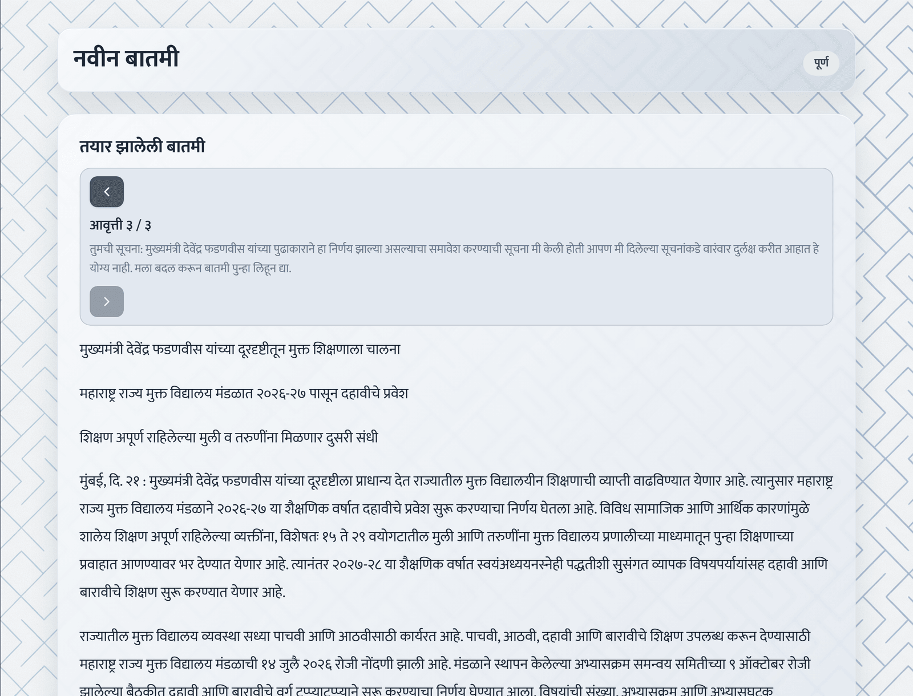
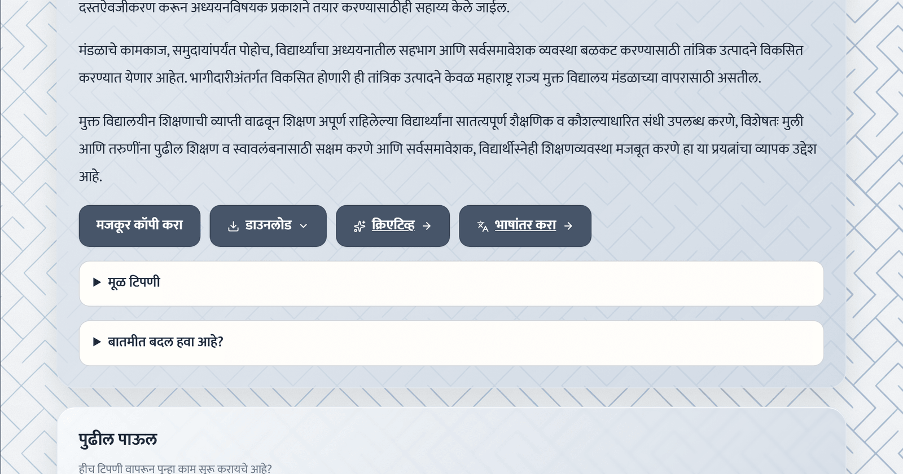
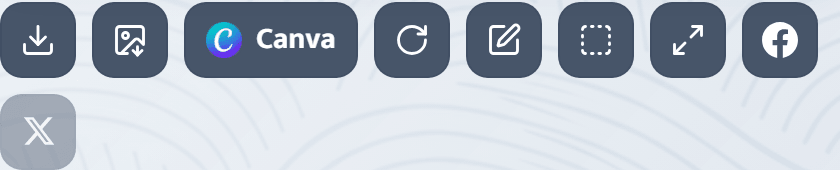

# Results and Downloads

Every run opens on its own result page. While work is still going on, the page shows its progress; you may leave and come back through **"सुरू असलेली कामे"** or **"मागील काम"**.

## Article result

On a news report the article appears on screen while it is being written, then settles into the finished article card.

The arrows at the top of the article move between its versions. Below the article are its actions:

- **"मजकूर कॉपी करा"**;
- **"डाउनलोड"** menu — **"PDF डाउनलोड"** (an A4 document with the DGIPR letterhead), **".txt डाउनलोड"** and **".md डाउनलोड"**;
- **"भाषांतर करा →"** — opens the article on the [translation page](translation.md);
- **"बातमीत बदल हवा आहे?"** — ask for a revision ([Improve Results with Feedback](improve-with-feedback.md));
- **"बातमीच्या आवृत्त्या"** — move between versions and select **"ही आवृत्ती पुन्हा वापरा"** to make an older one current;
- **"क्रिएटिव्ह →"** — start a poster from this article.

If English or Hindi versions already exist for the article, the **"मराठी"**, **"English"** and **"हिंदी"** tabs switch between them, and the PDF downloads in the visible language.

**"मूळ टिपणी"** shows the source used for the run; source files can be opened from there. Older runs may also show **"तथ्य-तपासणी (माहिती कुठून आली?)"**.

### Notices on an article

- **"मागितलेली लांबी गाठता आली नाही"** — the sources could not honestly fill the length you asked for.
- **"पदनामाबाबत लक्ष द्या"** — a designation could not be placed; check the names.
- **"अभिप्रायातून शिकलेले नियम"** — your feedback was saved as a standing rule for future articles. Use **"संपादकीय नियम तपासा किंवा बदला →"** to review it.


A complete-looking result is not publication approval. Check every person, designation, date, amount, quotation, eligibility rule and action against the official source.


## Poster, thumbnail, banner or social result

The image appears with its caption beside it.

The row of icons under the poster provides the following. Hover over an icon to see its name; some icons appear only on certain formats.

| Icon label                                     | What it does                                                         |
| ---------------------------------------------- | -------------------------------------------------------------------- |
| **"पोस्टर मोठ्या आकारात उघडा"**                | View at full size                                                    |
| **"पोस्टर डाउनलोड करा"**                       | Download the finished poster                                         |
| **"लोगो-फूटरशिवाय डाउनलोड करा"**               | Download the same poster without the badge and footer                |
| **"Canva मध्ये पोस्टर उघडा"**                  | Open the poster in your own Canva account to edit further            |
| **"वेगळी रचना तयार करा"**                      | Redraw with a different layout                                       |
| **"चित्रात बदल करा (पोस्टरवर खूण करा)"**       | Mark parts of the poster to change                                   |
| **"जागा मोकळी करा (स्वतःच्या लोगोसाठी)"**       | Clear a space for your own logo or photograph                        |

In Canva, the official badge and footer arrive as separate image layers; edit only the artwork layer so the branding stays intact. Posters made before September 2026, and banners in the older text-overlay style, have no logo-free download.

On a **बॅनर**, **"पोस्टरवरील मजकूर बदला"** lets you set the exact words to print and redraw.

If the poster says **"मुद्दे टेम्पलेटच्या क्षमतेपेक्षा जास्त आहेत"**, your text had more points than the chosen template holds. The poster was still made with every point; consider a larger template or splitting the text.

## If a task fails

The result page keeps any part that already finished and shows the failure beside the affected part. Use the offered retry only for the missing or failed part; do not start the whole journey again unless the source itself must change.
