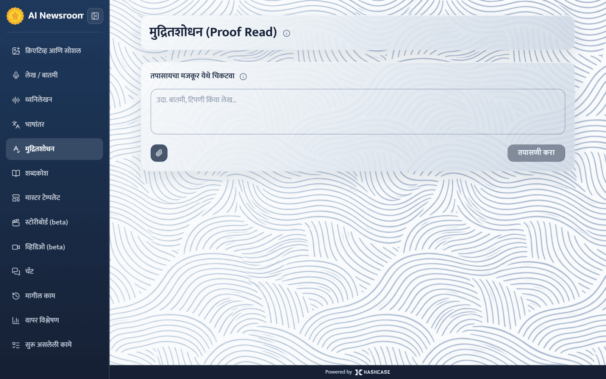
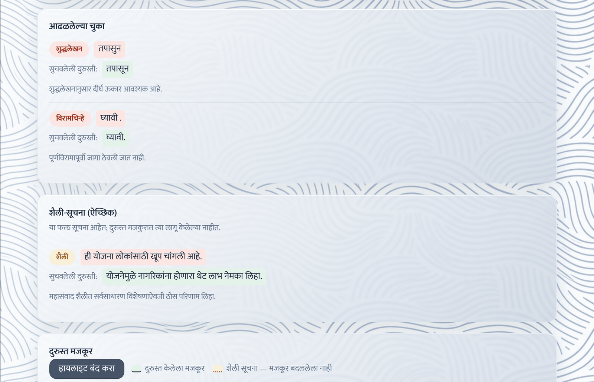
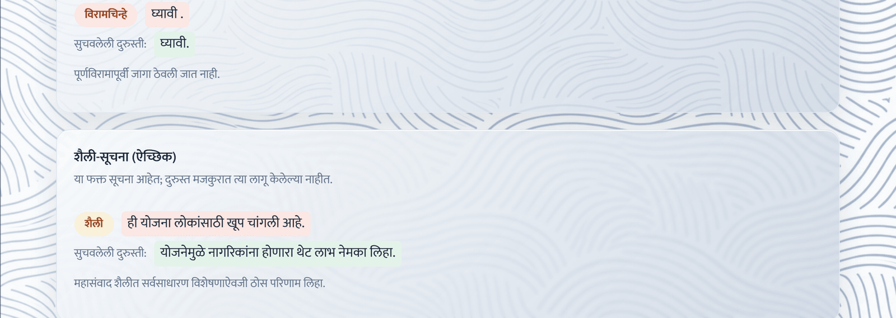

# Proofread Marathi or English

Use **"मुद्रितशोधन"** (page title **"मुद्रितशोधन (Proof Read)"**) to check text for grammar, spelling, punctuation, names and Mahasamvad style. Only confident errors are shown. Nothing is saved.

## Run the check

1. Paste text under **"तपासायचा मजकूर येथे चिकटवा"**, or select **"फाईल निवडा"** (the paperclip) to attach one or more PDF, DOCX or TXT files. Files are read in full when you press the button.
2. Select **"तपासणी करा"**.

Marathi text is also compared with Mahasamvad style; English text gets grammar and name checks only. The text is not rewritten — corrections are made only at the flagged places, so your layout stays as it was.

## Read the findings

Confirmed errors appear under **"आढळलेल्या चुका"**, grouped by type. Each row shows the original excerpt, the suggested correction and a short explanation.

Style advice appears separately under **"शैली-सूचना (ऐच्छिक)"** and is never applied automatically. Names that do not match the verified glossary are listed for you to confirm; they are not corrected silently.

## Use the corrected text

The **"दुरुस्त मजकूर"** card applies the confirmed corrections. Corrections are underlined and tinted; style advice is dotted. Hover or tap a highlight to see the original wording. Use the highlight button to show or hide the marks.

Select **"मजकूर कॉपी करा"** or download the TXT file. If an automatic correction would have changed a number, the corrected text is withheld and only the issues are shown — make that correction yourself against the source.


Proofreading does not fact-check. A grammatically clean sentence can still contain the wrong name, date, amount, designation or policy claim.

