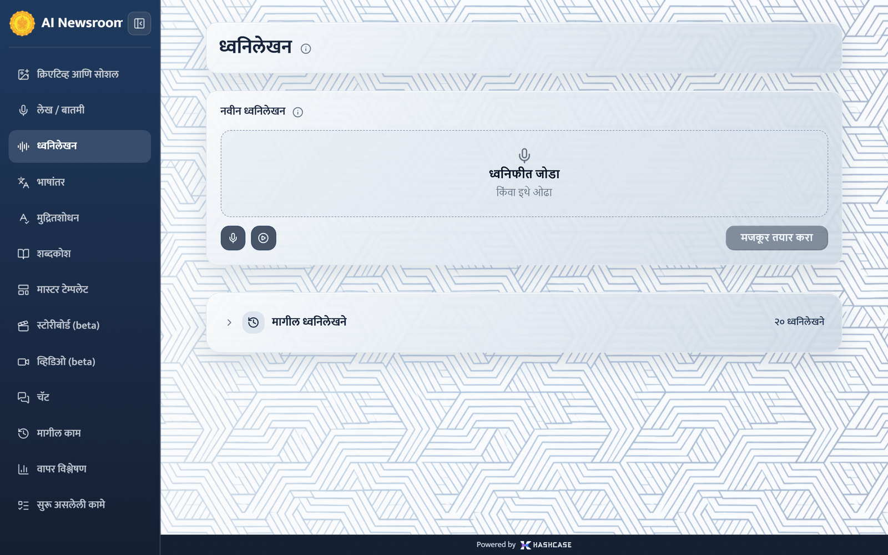
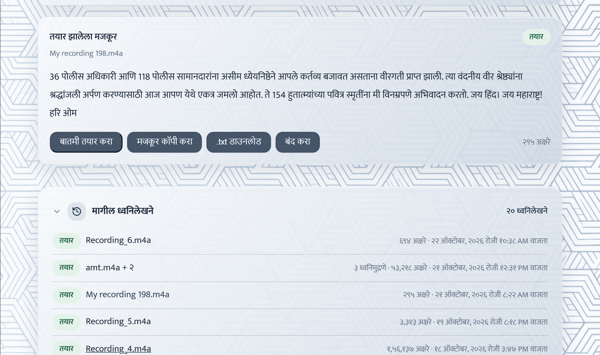

# Transcribe Recordings and YouTube

Use **"ध्वनिलेखन"** when you need what was said, word for word, before deciding what to make from it.

## Start a transcript

1. Under **"नवीन ध्वनिलेखन"**, select **"ध्वनिफीत जोडा"** (or drag files onto the card). To add a YouTube link, use the play button under the card.
2. Check every listed source.
3. Select **"मजकूर तयार करा"**.

What you can add:

- Up to ten recordings at a time, with no size limit — MP3, M4A, AAC, WAV, FLAC, OGG, OPUS and WEBM.
- Phone videos (MP4, MOV, MKV, 3GP): only the sound is taken out, in your browser, and the video is never uploaded.
- Large recordings are compressed in your browser before upload. **"अपलोड करत आहे… N %"** shows the upload progress; keep the page open until it finishes.

To transcribe only part of a recording, select its card, drag the edges of the waveform to the part you need and choose **"हाच भाग वापरा"**.

On an Android phone with the app installed, you can share a recording directly from WhatsApp or the recorder app to this page; the transcript starts automatically.

## Use the result

Earlier runs are listed under **"मागील ध्वनिलेखने"** on the same page; select one to open it. The transcript is read-only because it records what the speech service heard. You can:

- select **"मजकूर कॉपी करा"** or **".txt डाउनलोड"**;
- see which individual recording or link failed — the others are still transcribed;
- select **"बातमी तयार करा"** to start a news report from the transcript.

A recording that was transcribed before — here or on **लेख / बातमी** — is shown at once, marked **"आधीच्या ध्वनिलेखनातून"**, without being transcribed again.


A transcript is not a verified quotation record. Compare sensitive statements with the recording, especially names, designations, dates, amounts and English words spoken in Marathi sentences.

