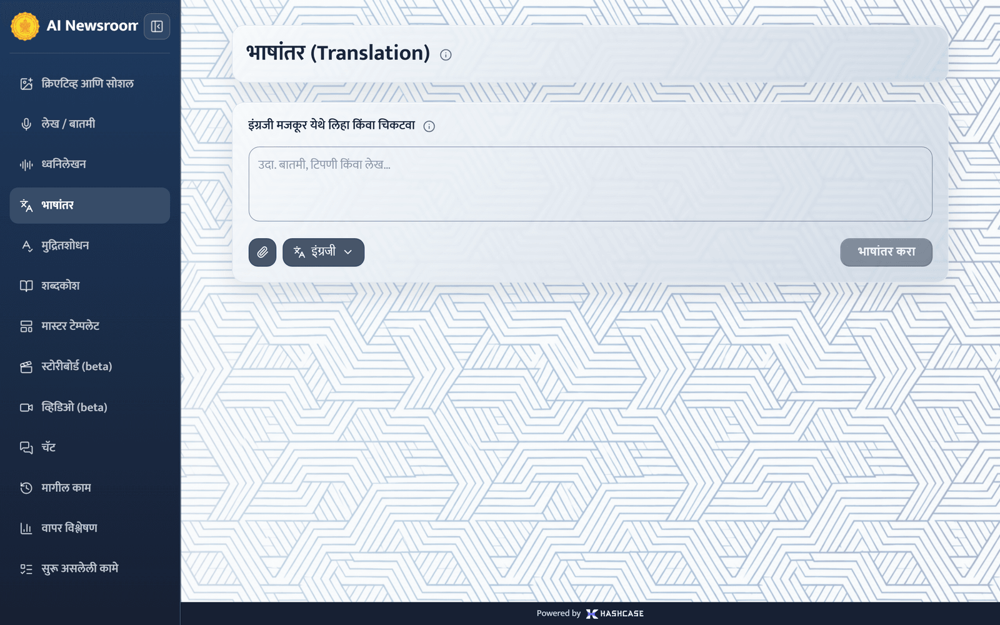
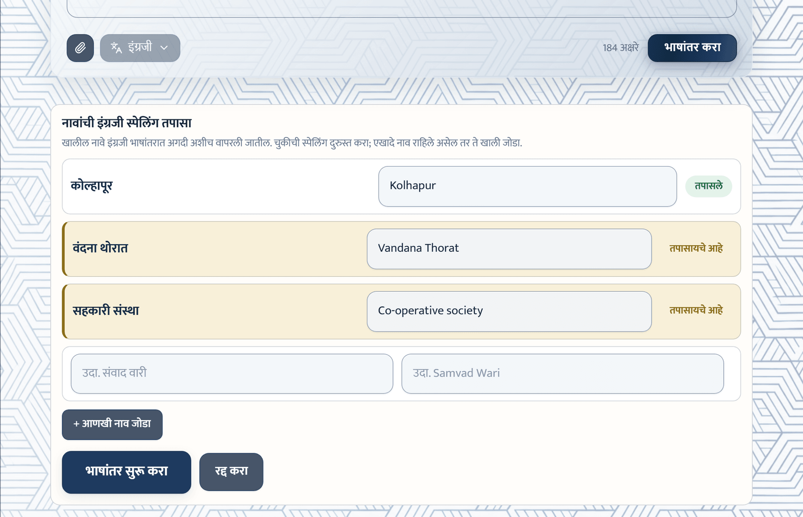
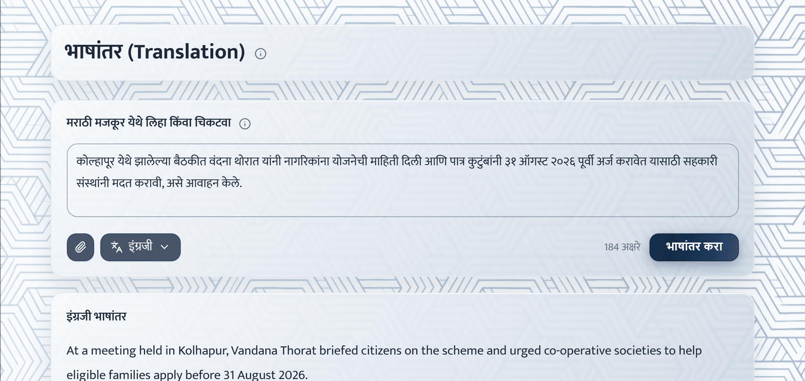

# Translate Text and Documents

Use **"भाषांतर"** (page title **"भाषांतर (Translation)"**) to translate between Marathi, English and Hindi. Names and designations follow the shared glossary. Nothing you translate here is saved, so copy or download the result before leaving the page.

## Translate

1. Paste text into the box, or select **"फाईल निवडा"** (the paperclip) to attach one or more PDF, DOCX or TXT files. Each file appears as a card in the box. You may combine pasted text and files.
2. Open the language menu beside the paperclip (**"कोणत्या भाषेत भाषांतर हवे?"**) and choose **"मराठी"**, **"इंग्रजी"** or **"हिंदी"**. The platform recognises the language of your text by itself.
3. Select **"भाषांतर करा"**.

Attached files are only checked when you add them. They are read in full when you press **"भाषांतर करा"** — a whole document can be translated at once, and the translation then continues by itself. Large texts can take a minute or two.

An article's **"भाषांतर करा"** link opens this page with the article already filled in.

## Review names before translating (from Marathi)

When the source is Marathi, the platform first lists the people, places, organisations and schemes it found. Check every row.

For English:

- confirm or correct each English spelling;
- add a missing name with **"+ आणखी नाव जोडा"**.

For Hindi:

- confirm or correct each Hindi spelling;
- keep **"हिंदीत जसेच्या तसे ठेवा"** ticked only for a proper name that must stay exactly as written; untick it for a common word or designation that should be translated normally.

Rows marked **"तपासले"** already match a verified glossary entry. Confirmed spellings are saved to the glossary for future work. Select **"भाषांतर सुरू करा"** to continue, or **"रद्द करा"** to go back.

## Use the result

Copy the result or download it as a text file. **"शब्दकोश संज्ञा वापरल्या"** lists the glossary terms that were locked during translation.

If the result shows **"ही नावे तपासा"**, the translation was delivered but those names could not be confirmed against the approved spelling. Compare and correct them before publication; there is no need to translate again.


Text from a scanned PDF is read by OCR and can contain misread names or digits. Check them in the result against the original document.

