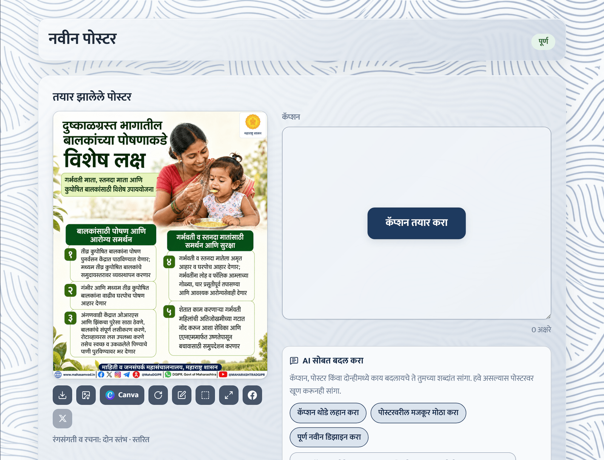

# Captions and Social Publishing

A social poster can carry a Marathi caption. There are three ways to get one:

- tick **"कॅप्शनही तयार करा"** before starting a Creative or Carousel;
- choose **"फक्त कॅप्शन"** in the format menu for a caption with no poster at all (no image cost);
- add one later from the result page.

## Edit or generate the caption

On the result page, the **"कॅप्शन"** box is editable; changes are saved automatically. Use **"कॅप्शन कॉपी करा"** to copy it. No length limit is enforced — check the platform's own limit before posting.

If no caption exists yet, the box shows **"कॅप्शन तयार करा"** — select it, or type a caption yourself.

 An AI caption uses only your source text and never adds a fact that was not in it.

For an AI-assisted change, write what you want in **"AI सोबत बदल करा"** under the caption — for example “कॅप्शन थोडे लहान करा”. See [Improve Results with Feedback](improve-with-feedback.md).

## Direct publication to Facebook

A finished poster shows a Facebook icon, **"फेसबुकवर पोस्ट करा"**, in its icon row. Publication is external and immediate:

1. Read the final caption and inspect the poster at full size.
2. Select **"फेसबुकवर पोस्ट करा"**.
3. Read the warning, then select **"होय, प्रकाशित करा"** only if you have publication authority.
4. After success, use **"प्रकाशित पोस्ट पाहा"** to open the live post.

The platform cannot withdraw the post. Remove or correct it through the official account if necessary.


Direct X publishing is currently unavailable; the X button reads **"सध्या X वर पोस्ट करता येणार नाही"**. A caption-only result and a carousel cannot be published from here either. Download the image and copy the caption for your authorised manual process.


## Reuse a result for social

Result pages may offer **"याच मजकुरावरून ट्विटर पोस्ट तयार करा"**, **"याच मजकुरावरून फेसबुक पोस्ट तयार करा"** or **"याच लेखावरून क्रिएटिव्ह पोस्टर तयार करा"**. These start a linked follow-up from the same source, shown in the work thread.
