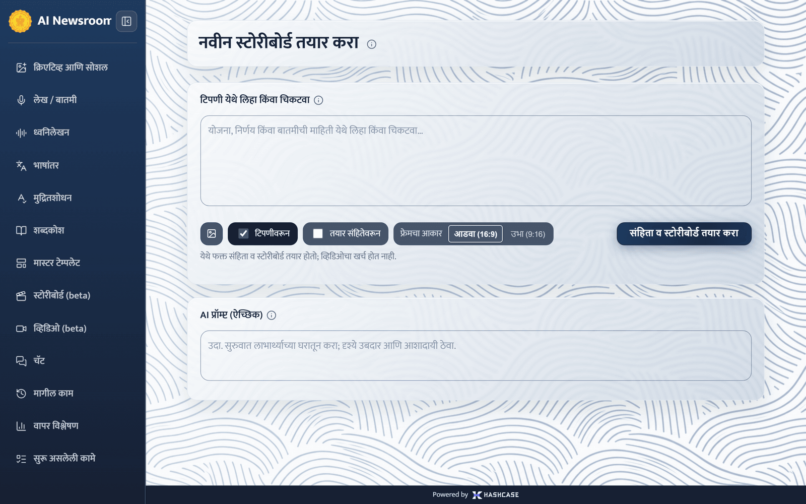
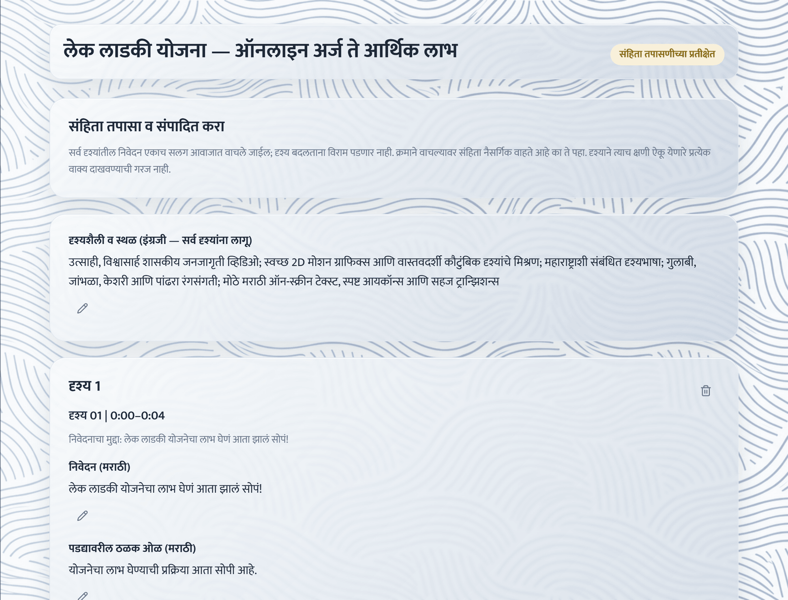
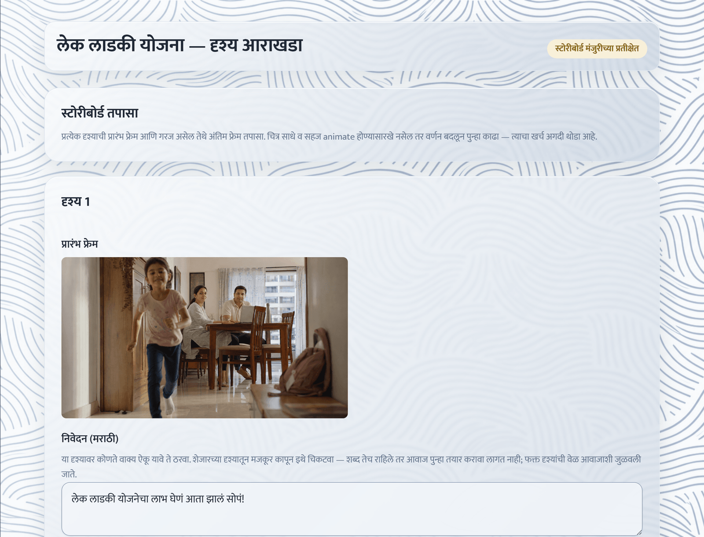
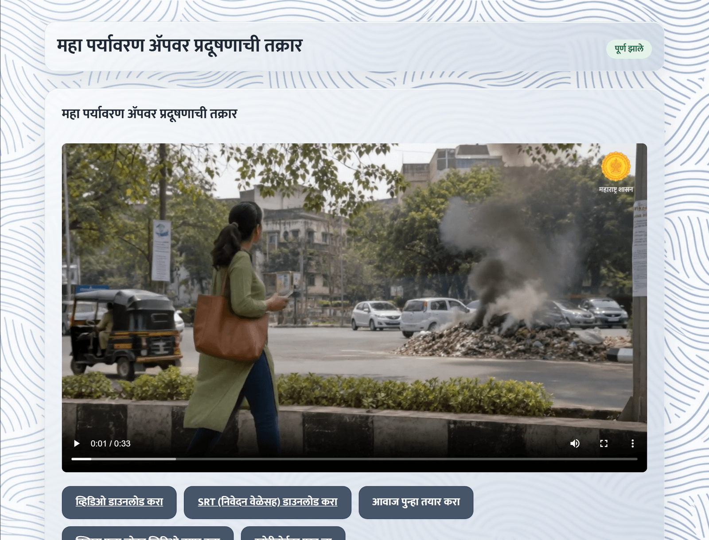

# Storyboard-to-Video Projects

This is a step-by-step project for a short Marathi explainer video, with two approval gates before the expensive animation step. Open it from **"क्रिएटिव्ह आणि सोशल"** → format menu → **"व्हिडिओ"** (page title **"नवीन स्टोरीबोर्ड तयार करा"**).

For a quicker, conversation-style way to work, see [Storyboards and Videos (Conversations)](video-conversations.md).

## 1. Choose the source

- **"टिपणीवरून"** — the platform writes a Marathi script from your factual note and divides it into storyboard scenes of at most five seconds each.
- **"तयार संहितेवरून"** — every word of your approved Marathi narration is kept unchanged while the platform divides it into scenes. Give only the words to be spoken — no scene directions or speaker names. You may also attach **"निवेदनाची ध्वनिफीत (ऐच्छिक)"**, a ready voice recording; it is then used as the voiceover and its length decides the scenes.

Then:

- **"AI प्रॉम्प्ट (ऐच्छिक)"** — what you want in your own words: what to stress, how the scenes should look, the tone. Facts still come only from the note or script.
- **"चित्रे जोडा"** — up to four reference pictures (a place, person, object or look) shown to the AI that plans the storyboard.
- **"फ्रेमचा आकार"** — **"आडवा (16:9)"** for YouTube/web or **"उभा (9:16)"** for reels, status and shorts.

Select **"संहिता व स्टोरीबोर्ड तयार करा"** (note) or **"स्टोरीबोर्ड तयार करा"** (ready script). This step does not spend on video. Only one project can be in progress at a time.

## 2. Approval gate: script

At **"संहिता तपासा व संपादित करा"**, review the overall visual style and each scene card: its title, Marathi narration, frame description (**"दृश्य / स्टोरीबोर्ड फ्रेम"**), key point and end-frame brief.

- Read all narration boxes in order — they become one continuous voiceover. In ready-script mode the narration is shown as **"निवेदन — जसेच्या तसे"** and cannot be changed.
- **"चित्र जोडा"** on a scene attaches your own photograph of a specific building, office or object; mention it in that scene's description. It applies once you select **"बदल जतन करा"**.
- **"AI ने दृश्य-वर्णन पुन्हा तयार करा"** rewrites the scene descriptions.
- **"दृश्य जोडा"** inserts a scene; you can also remove one.

Select **"स्टोरीबोर्ड तयार करा"** when the script is approved. This creates still frames, which are inexpensive.

## 3. Approval gate: storyboard

At **"स्टोरीबोर्ड तपासा"**, check each scene's start frame and end frame: a Maharashtra/India setting, plausible people and objects, no invented facts, and no stray writing.

You may change a frame description and redraw only that frame, use **"पहिली फ्रेमच वापरा"** for a scene that should not change, edit the motion brief, and select **"बदल जतन करा"**.

Select **"व्हिडिओ तयार करा"**, read the cost, then **"होय, व्हिडिओ तयार करा"**. This is the main paid step: every missing scene clip is animated.

## 4. Completed video

- **"व्हिडिओ डाउनलोड करा"** — the MP4.
- **"SRT (निवेदन वेळेसह) डाउनलोड करा"** — subtitles.
- **"पडद्यावरील ओळी व्हिडिओत दाखवा"** — show or hide the burned-in Marathi key points.
- **"आवाज पुन्हा तयार करा"** — redo the voiceover.
- **"क्लिप्स पुन्हा जोडून व्हिडिओ तयार करा"** — rebuild the video from stored clips and audio at no generation cost.
- **"स्टोरीबोर्डवर परत जा"** — change frames, scenes or narration.

**"वेळेसह निवेदन"** shows which narration plays in each time range. Every video carries the DGIPR badge and ends with the DGIPR contact slate.

## Improve one scene

Under **"एखादे दृश्य सुधारायचे?"**, change one scene's description, redraw its frames and select **"फक्त हे दृश्य पुन्हा तयार करा"**. Only that scene is animated again; the previous video stays available meanwhile.


Watch the complete MP4 with sound before publication. Check every spoken word, frame, subtitle timing, logo, outro and aspect ratio.

